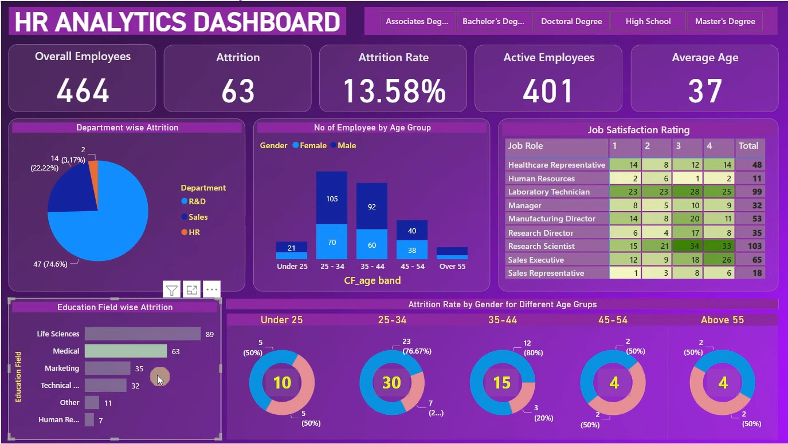

# HR Analytics Dashboard: Employee Attrition Analysis

An interactive **Power BI** dashboard that analyses employee attrition and workforce demographics, helping HR teams see who is leaving, from where, and what patterns sit behind it.



## Project Overview

Employee attrition is costly: lost knowledge, recruitment spend and lower morale. This dashboard turns raw HR records into a single view that answers questions such as:

- How many employees do we have, and what share has left?
- Which departments, age groups and education fields see the most attrition?
- How does attrition differ by gender across age bands?
- How satisfied are employees in each job role?

## Key Metrics

| Metric | Value |
|---|---|
| Overall employees | 464 |
| Attrition (employees who left) | 63 |
| Attrition rate | 13.58% |
| Active employees | 401 |
| Average age | 37 |

## Dashboard Features

- **KPI cards**: headcount, attrition, attrition rate, active employees, average age.
- **Department-wise attrition** (pie chart): R&D accounts for 47 leavers (74.6%), Sales 14 (22.2%) and HR 2 (3.2%).
- **Employees by age group and gender** (stacked bar): most employees fall in the 25-34 and 35-44 bands.
- **Job satisfaction heatmap**: ratings 1 to 4 across nine job roles, colour-scaled for quick comparison.
- **Education field-wise attrition** (bar chart): Life Sciences, Medical, Marketing, Technical, Other and Human Resources.
- **Attrition by gender across age groups** (donut charts): Under 25, 25-34, 35-44, 45-54 and Above 55.
- **Education-level slicers**: filter the whole report by Associate's, Bachelor's, Master's, Doctoral or High School.

## Key Insights

- Overall attrition is **13.58%**, with 63 of 464 employees having left.
- **R&D** contributes about three-quarters of all attrition.
- Attrition peaks in the **25-34 age group (30 leavers)**, followed by 35-44 (15).
- In the 25-34 and 35-44 groups, attrition is heavily skewed to one gender (76.7% and 80%), while the youngest and oldest groups are evenly split.

> Add your own recommendations here, for example retention programmes for early-career staff in R&D.

## Tools and Skills

- **Power BI Desktop**: data modelling, DAX measures, visuals, slicers
- **Power Query**: data cleaning and transformation
- **DAX**: calculated measures and columns (e.g. attrition rate, age bands)

## Repository Structure

```
hr-analytics-dashboard/
├── README.md
├── HR_Analytics_Dashboard.pbix   # Power BI report file
├── data/
│   └── hr_data.csv               # dataset (or link to source)
└── docs/
    └── dashboard.jpeg            # dashboard screenshot
```

## How to Use

1. Clone the repository:
   ```bash
   git clone https://github.com/<your-username>/hr-analytics-dashboard.git
   ```
2. Open `HR_Analytics_Dashboard.pbix` in **Power BI Desktop**.
3. If prompted, update the data source path under *Transform data → Data source settings*.
4. Use the education-level slicers to explore the dashboard.

## Data Source

<!-- Describe where the data comes from (e.g. Kaggle HR Analytics dataset, company data) and note whether it is synthetic or anonymised. -->

The dataset contains employee records including department, job role, age, gender, education level and field, job satisfaction rating and attrition status. No personally identifiable information is included.

## Author

**Vincent Munyaneza**
Data Scientist | MEL Specialist | MSc Applied Quantitative Economics (University of Rwanda)
[LinkedIn](https://www.linkedin.com/in/vincent-munyaneza-56390926a/)

